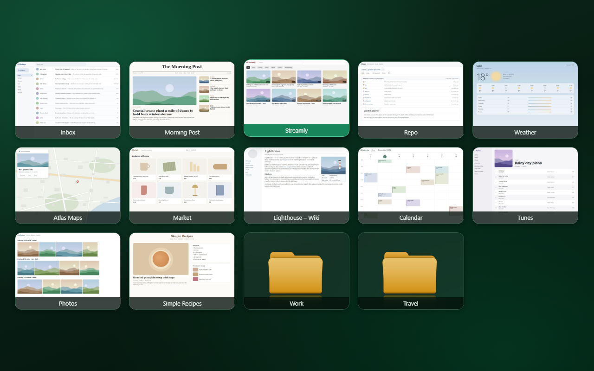
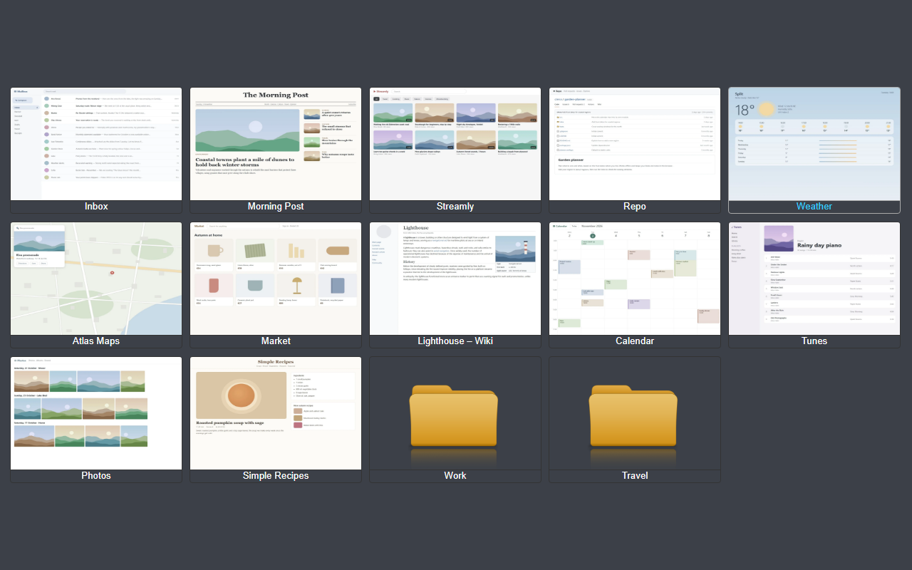
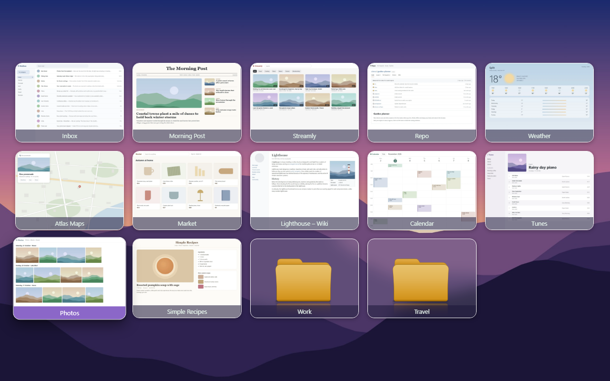
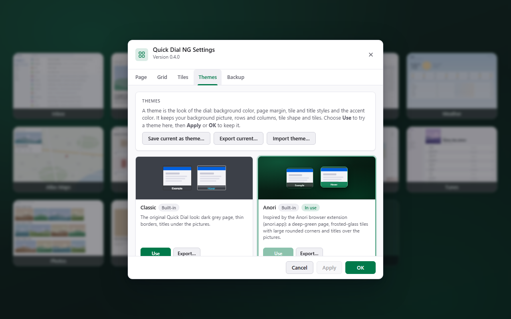
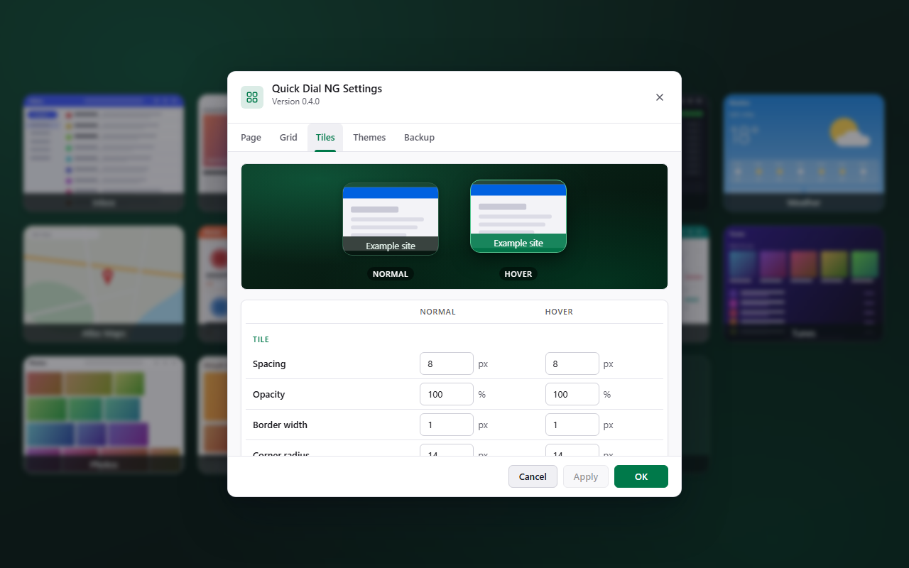

# Quick Dial NG

Quick Dial NG is a speed dial new tab page for Firefox. Its tiles come from a bookmarks folder ("Quick Dial" by default).

It is a fork of [Quick Dial](https://github.com/MatMoul/quickdial-webext) by MatMoul ([on addons.mozilla.org](https://addons.mozilla.org/firefox/addon/quick-dial/)). It works the same way, but its storage has been reworked so Firefox starts faster and uses less disk and memory, and it adds themes and redesigned settings.



| | |
|---|---|
|  |  |
| Classic theme | Your own theme over a background picture |
|  |  |
| Settings › Themes | Settings › Tiles with the live preview |

More in [screenshots](screenshots/): settings in dark mode, the Page and Grid tabs, tile properties. The sites on the tiles are made up for the pictures.

## What is different from Quick Dial 0.1.24

**Images are stored separately and loaded on demand.**
The original keeps every tile picture inside one big storage record (data URLs inside the node tree). Firefox reads that whole record at every start, and the bookmark sync that runs ~0.5 s after start writes it all back. With 73 tiles that was 21 MB read and rewritten on every launch.
Now each picture has its own storage key (`img_<bookmarkId>`). The startup record holds only settings and the tile tree, a few KB. The new tab page asks only for the pictures on the page you're looking at.

**Pictures are WebP.**
Captures and uploaded images are saved as WebP (quality 0.85) instead of PNG. Uploads are also limited to 1200 px on the longest side. On a real profile that took 10.5 MB of PNGs down to about 1.5 MB, with no visible difference at tile size.

**Saves only when something changed.**
Saves are batched (100 ms) and skipped when settings and tiles are unchanged, so a normal startup writes nothing.

**Bookmark events outside the Quick Dial folder are ignored.**
The original re-synced and saved on *any* bookmark change in the browser. Now only changes inside the Quick Dial tree trigger a sync.

**Unused images are removed.**
When a tile is deleted, its folder is removed, its URL changes, or the root folder is switched, its picture is deleted too.

**Fewer permissions.**
The hidden "Capture here" feature and the `webRequest`/`webRequestBlocking` permissions it needed are gone.

**Import from Quick Dial, backup and restore.**
Right-click the page → **Import from Quick Dial…** (or Settings → **Backup**) imports an original Quick Dial export or a Quick Dial NG backup: tiles keep their exact grid cells (gaps included), folders, pictures, per-tile options, grid and style settings. **Export backup** saves all of that to one JSON file.

**Start page without a timer.**
The original replaced blank tabs with the dial a set time after Firefox started (the "Startpage timeout" setting), which also caught blank tabs opened on purpose. Quick Dial NG instead sets itself as Firefox's home page, so the dial opens directly when Firefox starts and from the Home button. On a real profile the start tab begins loading at 0.8 s instead of 2.1 s after launch. Firefox asks once whether to keep the change; to use another page, go to Firefox Settings › Home.

**Reworked Settings and Properties.**
Settings and tile properties have a new layout that follows Firefox's light or dark mode, a live preview of the tile style, image drag-and-drop and paste, and an Apply button that shows when there are unsaved changes. New bookmark, new folder and delete use in-page dialogs instead of browser prompts.

**Themes.**
Settings → **Themes** switches the whole look of the dial at once: background color, page margin, tile and title styles and the accent color of Quick Dial NG's windows. A theme never changes your background picture, rows and columns, tile shape or tiles. **Use** shows a theme in the settings first; Apply or OK puts it on the dial. Two themes are built in: **Classic** (the original look) and **Anori**, inspired by the [Anori](https://anori.app/) browser extension. Save your current look as a theme, export any theme to a `.json` file and import theme files from others. Backups include your themes.
New style settings came with it: background opacity and glass blur for tiles, shadows, smooth hover effects (lift or grow), title font, bold titles and titles over the picture.

**Refresh no longer hangs.**
The automatic "Refresh" capture uses `drawWindow`, which recent Firefox no longer allows extensions to call. Instead of leaving a spinner forever, the tile now ends without a picture. Use **Capture in a new tab** to set one.

## Install

Download the latest `.xpi` from [Releases](https://github.com/YuriyWozniak/quickdial-ng/releases/latest). Each one is signed by Mozilla for self-distribution. In Firefox, open `about:addons`, click the gear icon and choose **Install Add-on From File**.

From 0.3.4 on, Firefox updates Quick Dial NG by itself: it checks [`updates.json`](updates.json) in this repository, which lists each release's download link and checksum.

## Moving from the original Quick Dial

Quick Dial NG has its own add-on ID, so it starts with empty storage. The import brings everything over:

1. Install Quick Dial NG (keep the original enabled for now).
2. Right-click the Quick Dial NG page → **Import from Quick Dial…**. The Backup tab opens with the steps:
   - Open `about:debugging#/runtime/this-firefox`, find the original **Quick Dial** and click **Inspect**.
   - Click **Copy export snippet** and paste it into the **Console** tab (Firefox may ask you to type `allow pasting` first). It saves `quickdial-export.json` to Downloads. The snippet is:
     ```js
     (async()=>{const a=(await browser.runtime.getBackgroundPage()).app;const l=document.createElement('a');l.href=URL.createObjectURL(new Blob([JSON.stringify({version:4,settings:a.settings,node:a.node})],{type:'application/json'}));l.download='quickdial-export.json';document.body.appendChild(l);l.click();})()
     ```
   - Click **Import from file…** and choose `quickdial-export.json`.
3. Check your tiles, then disable the original Quick Dial.

How the import links tiles to bookmarks: each tile is matched to a bookmark in the Quick Dial folder by its bookmark ID, then by URL (folders by name). Tiles without a match get a new bookmark, so an export also works in another Firefox profile or on another PC. Bookmarks already in the folder that the export doesn't mention stay and fill empty cells, as usual. Importing the same file twice creates nothing new.

## Development

- Source: `src/` (a Manifest V2 WebExtension).
- Lint: `npx web-ext lint -s src --self-hosted` (should report no errors, warnings or notices). `--self-hosted` is needed because the add-on is distributed from GitHub with its own `update_url`, which the linter otherwise rejects as if it were listed on addons.mozilla.org.
- Tests: `node test/test-storage.js` (after `npm install` in `test/`; see [test/README.md](test/README.md)). This runs the extension pages in Chromium (Playwright) against a simulated Firefox API (`test/mock.js`). It covers migration, startup writes, bookmark filtering, the dial page, export/import, import from the original Quick Dial (bookmark matching/creation, cell positions, settings defaults) and image cleanup.
- Screenshots: `npm run screenshots` in `test/` remakes the pictures in [`screenshots/`](screenshots/) from the current code, with invented sites (see [test/screenshots/README.md](test/screenshots/README.md)).
- Release: `node release/release.js <version> --notes <file>` signs `src/` on addons.mozilla.org (unlisted), publishes a GitHub release with the signed `.xpi` and adds it to `updates.json`, so installed copies update themselves. See [release/README.md](release/README.md) for setup and options.

## License

[Mozilla Public License 2.0](LICENSE), the same as the original Quick Dial.
