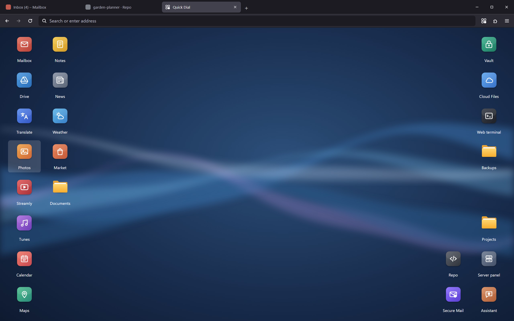
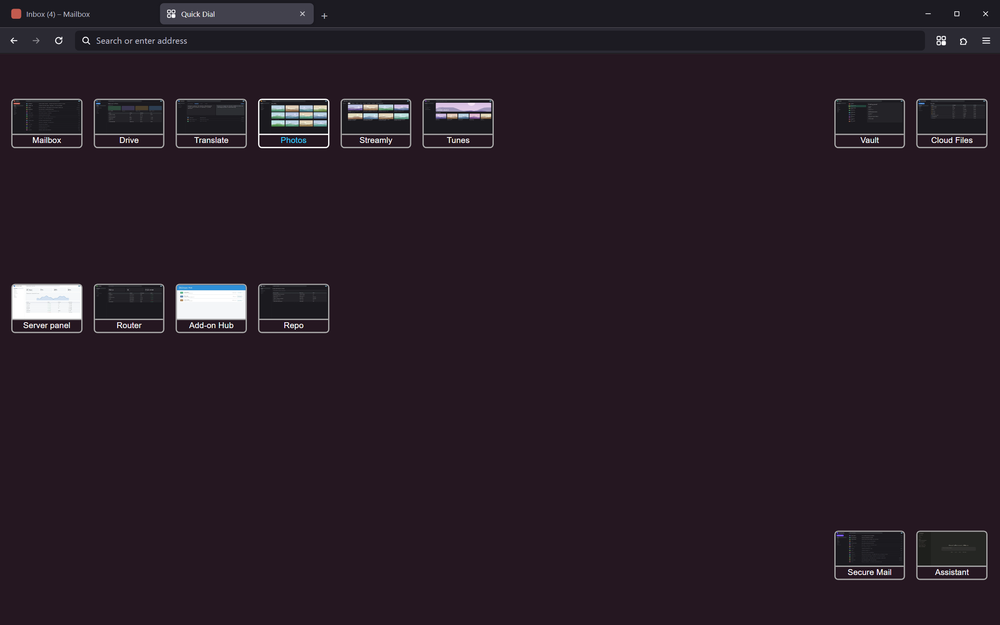
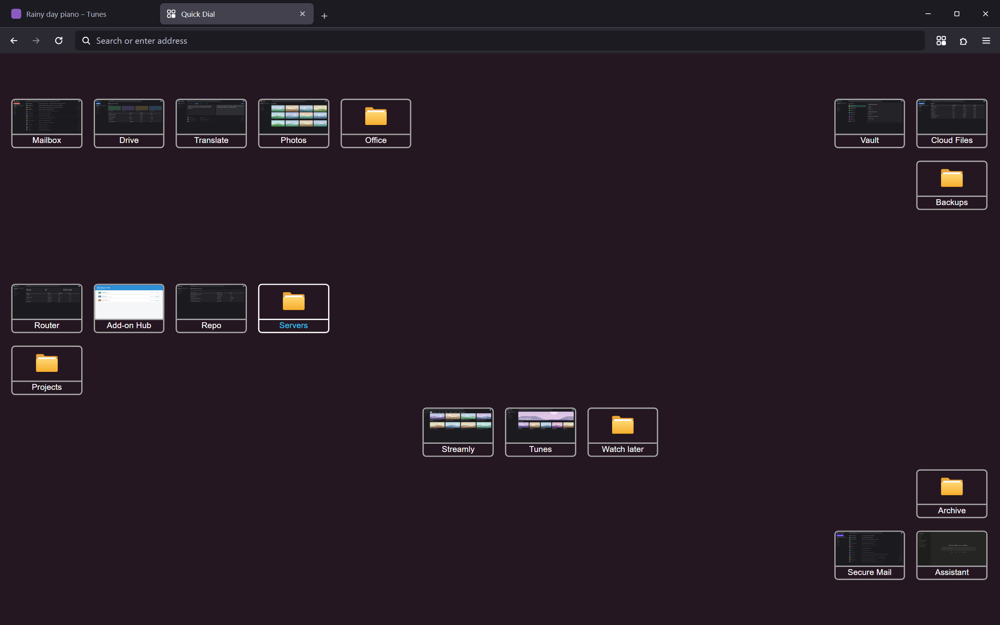
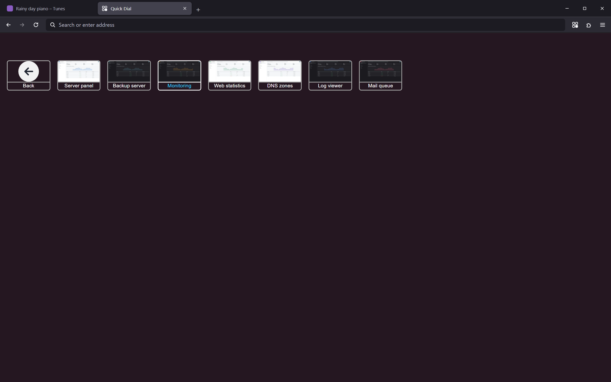
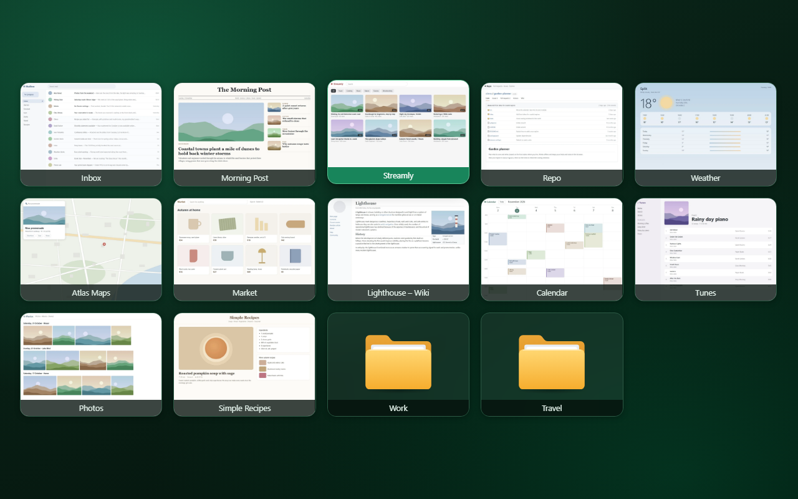
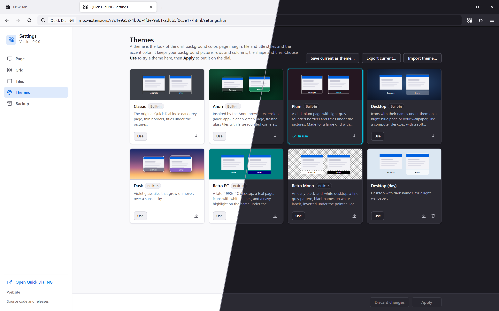
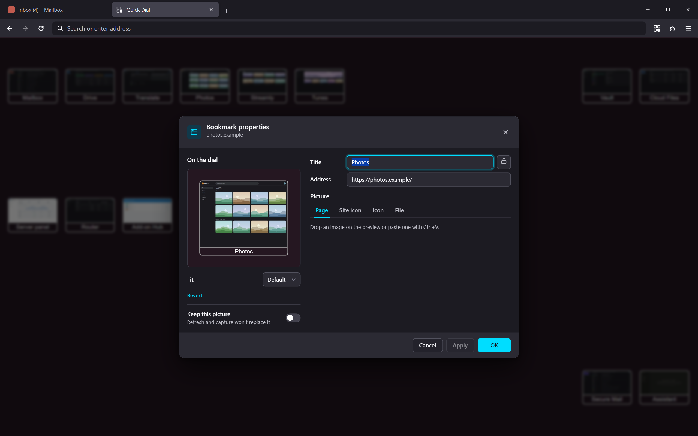

# Quick Dial NG

[](https://github.com/YuriyWozniak/quickdial-ng/actions/workflows/ci.yml)

Quick Dial NG is a speed dial new tab page for Firefox. Its tiles come from a bookmarks folder ("Quick Dial" by default).

Website: **[qdng.srv.if.ua](https://qdng.srv.if.ua)**: features, install and migration guide, privacy and changelog.

It is a fork of [Quick Dial](https://github.com/MatMoul/quickdial-webext) by MatMoul ([on addons.mozilla.org](https://addons.mozilla.org/firefox/addon/quick-dial/)). It works the same way, but its storage has been reworked so Firefox starts faster and uses less disk and memory, and it adds themes and redesigned settings.



| | |
|---|---|
|  |  |
| A large grid, sites grouped in the corners | Categories, with folders for the rest |
|  |  |
| A folder opened | The usual speed dial, Anori theme |
|  |  |
| Settings follow Firefox's light or dark mode | Bookmark properties |

More in [screenshots/website](screenshots/website/): the same dials in other themes, a daytime desktop, and every section of Settings. The sites and most icons are made up for the pictures; the retro icons come from open icon sets (see [Credits](#credits)).

## What is different from Quick Dial 0.1.24

**Images are stored separately and loaded on demand.**
The original keeps every tile picture inside one big storage record (data URLs inside the node tree). Firefox reads that whole record at every start, and the bookmark sync that runs ~0.5 s after start writes it all back. With 73 tiles that was 21 MB read and rewritten on every launch.
Now each picture has its own storage key (`img_<bookmarkId>`). The startup record holds only settings and the tile tree, a few KB. The new tab page asks only for the pictures on the page you're looking at.
The pictures chosen in Settings (background, Back and folder) have their own keys too, so saving after a tile change or a refresh doesn't write a large background picture again; each is written only when it changes.

**Pictures are WebP.**
Captures and uploaded images are saved as WebP (quality 0.85) instead of PNG. Uploads are also limited to 1200 px on the longest side (2560 px for the background picture, which fills the screen). On a real profile that took 10.5 MB of PNGs down to about 1.5 MB, with no visible difference at tile size.
The built-in folder, Back and loading pictures are SVG, so they stay sharp at any tile size and read on light and dark tiles.

**Saves only when something changed.**
Saves are batched (100 ms) and skipped when settings and tiles are unchanged, so a normal startup writes nothing.

**Bookmark events outside the Quick Dial folder are ignored.**
The original re-synced and saved on *any* bookmark change in the browser. Now only changes inside the Quick Dial tree trigger a sync.

**Unused images are removed.**
When a tile is deleted, its folder is removed, its URL changes, or the root folder is switched, its picture is deleted too.

**Fewer permissions.**
The hidden "Capture here" feature and the `webRequest`/`webRequestBlocking` permissions it needed are gone.

**Import from Quick Dial, backup and restore.**
Right-click the page → **Import from Quick Dial…** (or Settings → **Backup**) imports an original Quick Dial export or a Quick Dial NG backup: tiles keep their exact grid cells (gaps included), folders, pictures, per-tile options, grid and style settings. **Export backup** saves all of that to one JSON file.

**Start page without a timer.**
The original replaced blank tabs with the dial a set time after Firefox started (the "Startpage timeout" setting), which also caught blank tabs opened on purpose. Quick Dial NG instead sets itself as Firefox's home page, so the dial opens directly when Firefox starts and from the Home button. On a real profile the start tab begins loading at 0.8 s instead of 2.1 s after launch. Firefox asks once whether to keep the change; to use another page, go to Firefox Settings › Home.

**Reworked Settings and Properties.**
Settings and tile properties have a new layout that follows Firefox's light or dark mode, a live preview of the tile style, image drag-and-drop and paste, and an Apply button that shows when there are unsaved changes. New bookmark, new folder and delete use in-page dialogs instead of browser prompts.

**Settings in its own tab.**
Settings opens as a full page in its own tab, like the dashboards of other add-ons: from the toolbar button, the dial's right-click menu, or Firefox's Add-ons page (**Options**). Wide windows get a sidebar and the settings in two columns; the tile style table keeps its live preview beside it. If Settings is already open, that tab comes forward. **Ctrl+S** applies, **Discard changes** goes back to what the dial uses, and Firefox asks before closing the tab with changes not applied. Settings › Page › **Toolbar button** chooses what a click on the button opens: Settings (the default for new installs), the dial in a new tab, or the dial in the current tab (existing installs keep what they had). The button's right-click menu has both.

**Themes.**
Settings → **Themes** switches the whole look of the dial at once: background color, page margin, tile and title styles and the accent color of Quick Dial NG's windows. A theme never changes your background picture, rows and columns, tile shape or tiles. **Use** shows a theme in the settings first; **Apply** puts it on the dial. Seven themes are built in: **Classic** (the original look); **Anori**, inspired by the [Anori](https://anori.app/) browser extension; **Plum**, for a large grid with groups of sites; **Dusk**, glass tiles over a sunset; and three icon looks for square tiles with icon pictures: **Desktop**, **Retro PC** (a late-1990s PC desktop) and **Retro Mono** (an early black-and-white desktop). Save your current look as a theme, export any theme to a `.json` file and import theme files from others. Backups include your themes.
New style settings came with it: background opacity and glass blur for tiles, shadows, smooth hover effects (lift or grow), title font, bold titles and titles over the picture.
Settings → Tiles → **Click effect** plays an effect when a tile is clicked: Press, Bounce, Ripple, Flash or Pulse ring (None by default). The sample tiles show it as soon as it is chosen, and themes carry it. It starts on mouse down or Enter, so it shows even when the site opens in the same tab, and it is off when the system asks to reduce motion.

**Your language, or another one.**
Every text of the dial, Settings, Properties, the dialogs and the menus comes from the language files, in 11 languages: English, German, Spanish, French, Hebrew (right to left), Italian, Polish, Portuguese (Brazil), Russian, Serbian and Ukrainian, each with its own plural forms. By default Quick Dial NG follows Firefox's language; Settings → Page → **Language** picks another one. Firefox's Add-ons page keeps showing the name and description in Firefox's language.

**Refresh and Capture no longer hang.**
The automatic "Refresh" capture uses `drawWindow`, which recent Firefox no longer allows extensions to call. Instead of leaving a spinner forever, the tile now ends without a picture. Use **Capture in a new tab** to set one.
The page that Refresh downloads is only drawn, never run: it goes into a sandboxed frame, so none of its scripts, forms or pop-ups run inside the extension. Only web addresses (`http`, `https`) are downloaded, and **New bookmark** refuses `javascript:` and `data:` addresses.
**Capture in a new tab** takes a page that never finishes loading after 30 seconds, always closes its tab, and captures nothing if another tab is in front by then. If Firefox can't read the stored data at startup, Quick Dial NG tries again and then starts with the defaults, without saving them over your data.

**Site icons and letter tiles.**
A tile's picture can also be the site's own icon: right-click the tile → **Picture › Use site icon**, or in its Properties choose **Site icon** as the picture's source, where the site's icons (largest first, SVG before all) and a letter tile are shown side by side. The icons come only from the site itself: the icons its page links to, its web app manifest and `/favicon.ico`, never from a favicon service, so no other server learns the addresses on your dial. Each icon is drawn in the middle of a transparent picture, so the tile's own colour shows around it, which suits the icon themes; a small icon is enlarged by whole pixels and stays sharp. A site without an icon gets a letter tile: the first letter of its address on a colour of its own. **Refresh** makes the same kind of picture again: an icon stays an icon, a letter tile stays a letter tile, and a picture you chose yourself is kept. **Capture in a new tab** turns the tile back to a screenshot; if the capture fails, the icon stays.

**What new tiles get.**
In Settings › Tiles › Thumbnails, **New tiles get** chooses the picture a new tile starts with: a screenshot of the page (as before), the site's icon (a letter tile when it has none), or the site's icon with a screenshot for sites without one. **Apply to tiles…** gives the tiles you have now pictures made the same way, after asking; pictures you chose yourself and pictures you keep (**Keep picture** in Properties) are never replaced. The Desktop, Retro PC and Retro Mono themes are drawn for icons: using one offers site icons for new tiles in the same step, and switching themes never changes the tiles' pictures by itself.

**Icons from icon sets.**
In a tile's Properties, the **Icon** source offers icons from three open icon sets: Outline ([Tabler Icons](https://tabler.io/icons), MIT), Pixel ([Pixelarticons](https://pixelarticons.com), MIT) and Retro color (the [SerenityOS](https://github.com/SerenityOS/serenity) icons, BSD 2-Clause). None of them comes with the extension: the picker shows each set's size and licence, and **Download** gets it once from this project's [GitHub releases](https://github.com/YuriyWozniak/quickdial-ng/releases), checked against a fingerprint built into the extension (a file that doesn't match is refused). A downloaded set is kept in the browser, works offline, and can be removed again; it isn't part of backups. When a newer version of a set comes with a new version of Quick Dial NG, the picker offers **Update**. Search a set by the icons' English names and words, choose an icon, its colour and, if you like, a coloured square behind it: the icon becomes the tile's own picture, so **Refresh** keeps it, and removing the set later changes no tile.

## Permissions and privacy

Quick Dial NG collects no data and sends nothing anywhere. Everything stays in your Firefox profile: settings and pictures in the extension's storage, tiles in your bookmarks.

| Permission | Why |
|---|---|
| Bookmarks | Tiles are the bookmarks of one folder ("Quick Dial" by default); adding, editing or deleting a tile changes that bookmark. |
| Access your data for all websites | **Capture in a new tab** takes a screenshot of the site (as you see it, signed in), **Refresh** downloads the page to read its title, and **Site icon** downloads the site's own icons (signed in too). An icon set you download in Properties comes from this project's GitHub releases, without cookies. |
| Tabs | Opens the site in a background tab for the capture and closes it afterwards; opens the dial or Settings from the toolbar button, and brings an open Settings tab forward. |
| Menus | The right-click menu on the dial (new bookmark, properties, picture, settings…) and on the toolbar button. |
| Storage | Settings, themes and tile pictures. |

It also replaces the new tab page and sets itself as the home page. Firefox asks once whether to keep the home page; to use another one, go to Firefox Settings › Home.

## Install

Quick Dial NG is for Firefox on the desktop, version 140 or later. Firefox for Android doesn't let extensions replace the new tab or home page, so it isn't offered there.

[](https://addons.mozilla.org/firefox/addon/quick-dial-ng/)

**From addons.mozilla.org (recommended):** open [Quick Dial NG on Firefox Add-ons](https://addons.mozilla.org/firefox/addon/quick-dial-ng/) and click **Add to Firefox**. Firefox keeps it up to date from there.

**From GitHub:** download the latest `.xpi` from [Releases](https://github.com/YuriyWozniak/quickdial-ng/releases/latest). Each one is signed by Mozilla, and from 0.4.1 on it is the same file as on addons.mozilla.org. In Firefox, open `about:addons`, click the gear icon and choose **Install Add-on From File**.

Copies installed from GitHub (0.3.4 to 0.4.0) update themselves through [`updates.json`](updates.json) in this repository, which lists each release's download link and checksum. Once they reach 0.4.1 they update from addons.mozilla.org, like copies installed there.

What changed in each version is on the [Releases](https://github.com/YuriyWozniak/quickdial-ng/releases) page and in [release/amo-listing.md](release/amo-listing.md#release-notes), which also holds the texts of the addons.mozilla.org page, so both places describe the same thing.

## Moving from the original Quick Dial

Quick Dial NG has its own add-on ID, so it starts with empty storage. The import brings everything over:

1. Install Quick Dial NG (keep the original enabled for now).
2. Right-click the Quick Dial NG page → **Import from Quick Dial…**. Settings opens on **Backup** with the steps:
   - Open `about:debugging#/runtime/this-firefox`, find the original **Quick Dial** and click **Inspect**.
   - Click **Copy export snippet** and paste it into the **Console** tab (Firefox may ask you to type `allow pasting` first). It saves `quickdial-export.json` to Downloads. The snippet is:
     ```js
     (async()=>{const a=(await browser.runtime.getBackgroundPage()).app;const l=document.createElement('a');l.href=URL.createObjectURL(new Blob([JSON.stringify({version:4,settings:a.settings,node:a.node})],{type:'application/json'}));l.download='quickdial-export.json';document.body.appendChild(l);l.click();})()
     ```
   - Click **Import from file…** and choose `quickdial-export.json`.
3. Check your tiles, then disable the original Quick Dial.

How the import links tiles to bookmarks: each tile is matched to a bookmark in the Quick Dial folder by its bookmark ID, then by URL (folders by name). Tiles without a match get a new bookmark, so an export also works in another Firefox profile or on another PC. Bookmarks already in the folder that the export doesn't mention stay and fill empty cells, as usual. Importing the same file twice creates nothing new.

## Development

- Source: `src/` (a Manifest V2 WebExtension): plain scripts, no build step and no libraries. The background page is `src/js/background/` (one file per part, listed in [`app.js`](src/js/background/app.js)); the pages are `dial.html`, `html/settings.html` and `html/properties.html`, each with its script in `src/js/`; the dial has two: `grid.js` draws the tiles and `dial.js` gets them from the background page and handles the mouse, the keyboard and the tile commands. Message commands, node types and picture helpers shared by all of them, and the pages' message client (`QDClient`), are in `src/js/common.js`; helpers for the Settings and Properties pages (and the dial's dialogs and popup frame) are in `src/js/ui.js`. Styles: `src/css/ui.css` (tokens, controls and dialogs, on every page), `page.css` (Settings and Properties) and `settings.css` (Settings only). Texts: `src/_locales/<language>/messages.json`, read through `QDCommon.text` so the language chosen in Settings applies (see [CODE_STYLE.md](CODE_STYLE.md) for adding a language).
- Code check: `npm install --include=dev`, then `npm run check`: [ESLint](eslint.config.mjs) for `src/js`, the stylesheets in `src/css` and the tests, with the project's own rules in [`eslint-rules/`](eslint-rules/) (descriptive names, CSS class and token names, colours only from tokens; `npm run lint:fix` fixes what it can) and TypeScript's checker for the background page ([jsconfig.json](jsconfig.json), no build: the same check VSCodium shows while editing). Formatting and naming: [CODE_STYLE.md](CODE_STYLE.md).
- Package check: `node release/lint.js src --self-hosted` runs `web-ext lint` and passes only with no errors, warnings or notices except one: without `gecko_android` (the add-on is for the desktop only) the linter warns that `data_collection_permissions` needs Firefox for Android 142. `--self-hosted` is needed because the add-on is distributed from GitHub with its own `update_url`, which the linter otherwise rejects as if it were listed on addons.mozilla.org. The package for addons.mozilla.org is the same source without `update_url`; `release.js --amo` lints it with the listed rules.
- Tests (see [test/README.md](test/README.md)):
  - Unit tests: `npm run test:unit`. They run in plain Node and need nothing installed. They cover the logic: themes, settings upgrades, the tile tree, backups and pictures, the language choice, and that every language file has every text.
  - Integration tests: `npm install` in `test/`, then `npm test` there (unit tests too) or `npm test -- dial sync` for some areas. They run the extension pages in Chromium (Playwright) against a simulated Firefox API (`test/mock.js`), one suite per area, each from a fresh profile. `npm run coverage` in `test/` shows which code the tests run.
- Screenshots: `npm run screenshots` in `test/` remakes the pictures in [`screenshots/`](screenshots/) from the current code, with invented sites (see [test/screenshots/README.md](test/screenshots/README.md)).
- Release: bump `version` in `src/manifest.json` and add its notes to [release/amo-listing.md](release/amo-listing.md) in a pull request; once it is merged, the **Release** workflow (Actions tab) tests the commit, builds the package and, after your approval, submits it to addons.mozilla.org and tags it. When Mozilla approves the version, the **Publish** workflow puts the same signed `.xpi` on GitHub Releases. `node release/release.js` is the manual way from a PC. See [release/README.md](release/README.md) for setup and options.

## Feedback

Bugs and ideas: [open an issue](https://github.com/YuriyWozniak/quickdial-ng/issues/new/choose). Security problems: see [SECURITY.md](SECURITY.md). Contributing: [CONTRIBUTING.md](CONTRIBUTING.md).

## License

[Mozilla Public License 2.0](LICENSE), the same as the original Quick Dial.

## Credits

- [Quick Dial](https://github.com/MatMoul/quickdial-webext) by MatMoul, which Quick Dial NG is a fork of.
- The icon sets you can download for the icon picker (made by [release/make-icon-sets.js](release/make-icon-sets.js); each file carries its licence):
  - Outline: [Tabler Icons](https://tabler.io/icons) by Paweł Kuna, [MIT License](https://github.com/tabler/tabler-icons/blob/main/LICENSE).
  - Pixel: [Pixelarticons](https://pixelarticons.com) by Gerrit Halfmann, [MIT License](https://github.com/halfmage/pixelarticons/blob/master/LICENSE).
  - Retro color: icons from [SerenityOS](https://github.com/SerenityOS/serenity), © the SerenityOS developers, [BSD 2-Clause License](https://github.com/SerenityOS/serenity/blob/master/LICENSE).
- Icons in the retro screenshots (they are not part of the extension):
  - Retro PC: icons from [SerenityOS](https://github.com/SerenityOS/serenity), © the SerenityOS developers, [BSD 2-Clause License](test/screenshots/retro-icons/LICENSE).
  - Retro Mono: [Pixelarticons](https://pixelarticons.com) by Gerrit Halfmann, [MIT License](https://github.com/halfmage/pixelarticons/blob/master/LICENSE).
- All other pictures in the screenshots (sites, icons, wallpapers) are made up for them by the screenshot maker.
